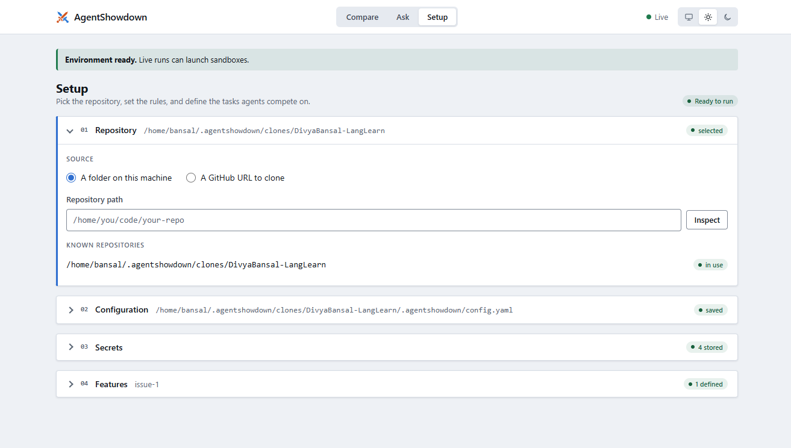
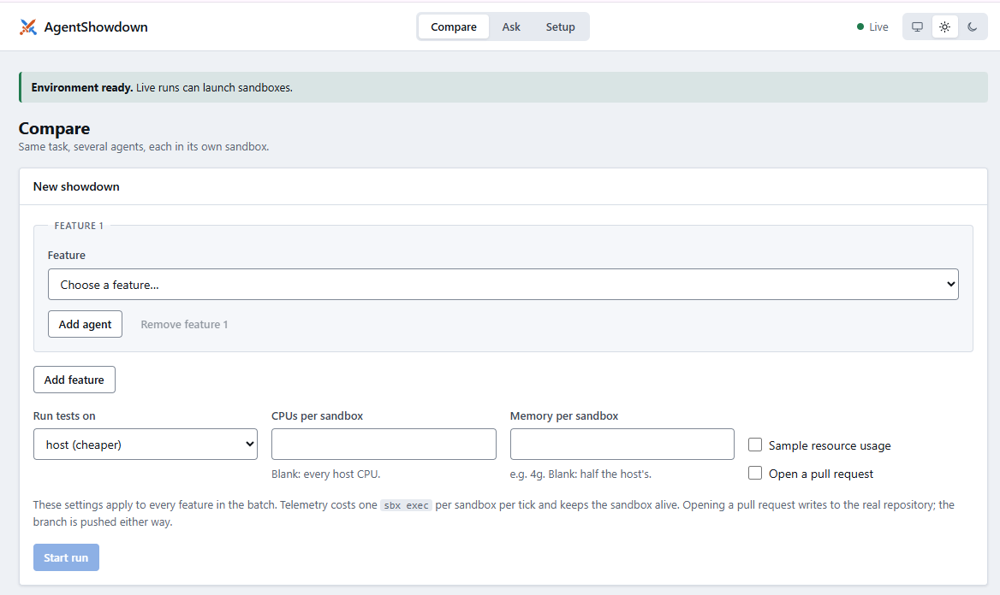
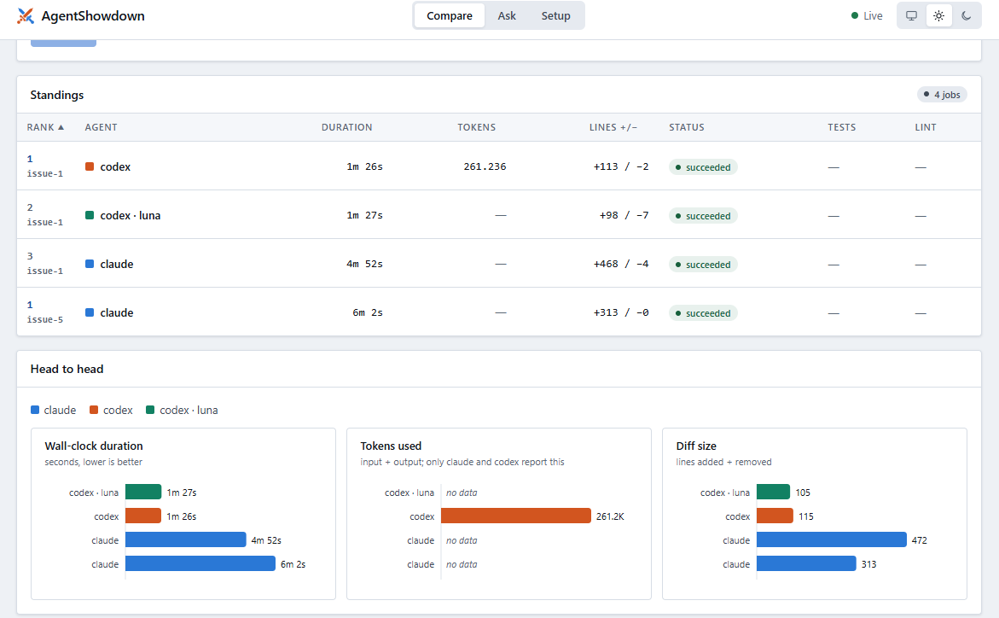
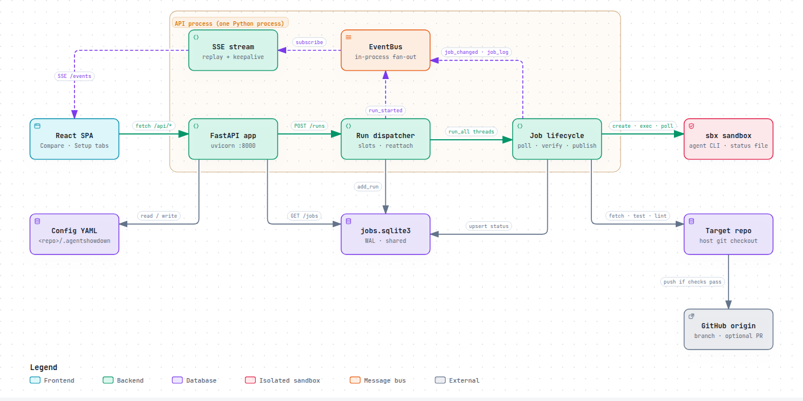

<p align="center">
  
</p>

<h1 align="center">AgentShowdown</h1>

<p align="center">
<br>
<b>Run and compare different coding agents and models in parallel Docker sandboxes.<br>
Choose your own harness.<br>
Don't rely on the hype.</b>
</p>

<p align="center">
  
  <a href="https://github.com/astral-sh/uv"></a>
  <a href="https://github.com/astral-sh/ruff"></a>
  <a href="https://github.com/astral-sh/ty"></a>
  
</p>

> [!NOTE]
> **Status: alpha (v0.2.0).** Usable day to day, with rough edges. `claude` and
> `codex` are verified end to end; other agents are best-effort. Only tested on
> Linux (see [Platform and sizing](#platform-and-sizing)).

<table>
  <tr>
    <td></td>
    <td></td>
    <td></td>
  </tr>
  <tr>
    <td align="center"><b>1. Setup</b></td>
    <td align="center"><b>2. Start a run</b></td>
    <td align="center"><b>3. Compare</b></td>
  </tr>
</table>

## Why?

You get one interface to run any model + agent combination in a sandbox and
compare how it performs, without touching your current workflow. Launch
`(feature × agent)` jobs headless, wait, and compare the metrics at the end.

**Benchmark coding agents on your own work.** Benchmarks like SWE-bench and
Terminal-Bench score agents on a fixed, public task set: someone else's repos,
someone else's tests, and tasks that may already be in the model's training
data. AgentShowdown runs agents on your repo, your backlog and your tests, so
the results tell you which setup works best for *your* code.

## How?

1. Choose a local folder or a Git repo, in the web UI's Setup tab or in the config file.
2. Write the features to work on, or pull them in from GitHub issues.
3. Pick the agent and model that should implement each one.
4. Every job runs in its own Docker sandbox, in parallel.
5. Run everything from the web UI or from the terminal.

Each finished job reports its diff size, whether tests and lint pass, wall-clock
time and token usage.

## Why Docker Sandboxes?

Each sandbox is a microVM with its own kernel, not a container that shares
the host's kernel. That's the strongest isolation of the common options:
stronger than OS-level process sandboxes (bubblewrap, Seatbelt, Landlock), plain
Docker containers or gVisor. An agent can only touch the files and network
access its sandbox gets, so agents can safely run with permission prompts
skipped (`dangerously_skip_permissions: true`, the web UI's default). A run
needs no one to approve each command, which is what lets jobs run headless and
in parallel.

## What you can compare

- **Agents and models:** `claude` vs `codex` vs …, or one agent on different models.
- **Skills:** run the same agent and model twice with different `run_label`s,
  and give one of them a `kit` that carries the skill (passed to
  `sbx create --kit`; sbx marks kits as experimental).
- **Prompts:** describe the same task as two features, worded differently
  (for example a one-line request vs. a detailed spec), run both, and see
  which description gets the better result.
- **Variance:** the same agent, model and prompt twice, to see how much of a
  difference is just chance.

```yaml
# features.yaml: does the skill help?
features:
  - id: add-separable-verbs
    description: Add separable-verb practice to the German terminal app.
    agents:
      - agent_id: claude
        run_label: plain
      - agent_id: claude
        run_label: with-skill
        kit: [/abs/path/to/german-grammar-skill]   # dir, zip or OCI ref
```

## Requirements

- Python 3.12+ and [`uv`](https://docs.astral.sh/uv/)
- [`sbx`](https://docs.docker.com/ai/sandboxes/install/), the Docker Sandboxes
  CLI, signed in with a Docker account (`sbx login`). On Linux it needs KVM, and
  your user must be in the `kvm` group.
- `gh` (GitHub CLI), authenticated
- Access to a model for each agent you compare. Inside a sandbox, agents don't
  use your host logins. Give them either:
  - an API key, stored with sbx: `sbx secret set anthropic` for `claude`,
    `sbx secret set openai` for `codex` (see `sbx secret set --help` for others), or
  - a local [Ollama](https://ollama.com) model, through the agent's `env` (see
    [Configuration](#configuration)).
- Node 22 for the web UI

## Platform and sizing

AgentShowdown runs on **Linux**. It has only been tested on this machine:

| | |
|---|---|
| OS | Ubuntu 24.04.5 LTS, kernel 6.8 |
| CPU | AMD EPYC 9354P, 32 cores / 64 threads |
| RAM | 188 GiB |
| Sandbox runtime | `sbx` v0.48.0, Docker 29.8 |

Each sandbox is a small VM. Measured on that machine (resident memory of the
sandbox's VM process on the host):

| Sandbox state | Host memory |
|---|---|
| Idle, nothing running | ~1.5 GiB |
| While the agent's work uses *N* GiB | ~1.5 GiB + *N* |
| After that memory is freed | back to ~1.5 GiB |

How many sandboxes you can run in parallel depends on the agent and on the
repo's build and tests, so there is no fixed number. As a rule of thumb, plan
for **2–3 GiB of RAM per sandbox**, plus whatever your test suite needs. Coding
agents mostly wait on the model, so memory usually runs out before CPU does.
Concurrency is set by `max_concurrency` (default 3).

By default sbx gives each sandbox every host CPU and half the host's RAM (at
most 32 GiB). That default is a ceiling, not a reservation. To set a hard cap,
use `--cpus` / `--memory` on `run`, or the *CPUs/Memory per sandbox* fields in
the web UI. The memory limit can range from 512 MiB to 75% of host RAM.

## Quickstart

```bash
git clone https://github.com/DivyaBansal/AgentShowdown.git && cd AgentShowdown
uv sync --all-groups
sbx login                                          # opens a browser to sign in to Docker
sbx daemon start
sbx secret set github --command "gh auth token"    # lets sandboxes push branches
sbx secret set anthropic                           # and/or openai, for the agents you use
```

**Demo target.** The examples below use [`demo/langlearn/`](demo/langlearn/),
which runs agents against [LangLearn](https://github.com/DivyaBansal/LangLearn),
a small German-practice terminal app with its own tests. Clone it next to this
repo (the config expects `../langlearn`):

```bash
git clone https://github.com/DivyaBansal/LangLearn.git ../langlearn
```

A successful job pushes its branch to the target repo's `origin`. To let that
push succeed, fork LangLearn, clone your fork instead, and set `github.repo` in
`demo/langlearn/config.yaml` to your fork.

**Web UI**

```bash
uv run uvicorn backend.main:app --reload --host 127.0.0.1 --timeout-graceful-shutdown 5   # API on :8000
cd frontend && npm install && npm run dev                                                # UI on :5173
```

**Terminal**

```bash
uv run python -m backend.orchestrator \
  --config demo/langlearn/config.yaml --features demo/langlearn/features.yaml \
  run --feature-id add-separable-verbs --max-concurrency 2

uv run python -m backend.orchestrator --config demo/langlearn/config.yaml status --watch
```

> [!WARNING]
> AgentShowdown has no authentication and runs commands on the host. Bind it to
> `127.0.0.1` and never expose the port to a network.

## Configuration

Two YAML files, stored in `<repo>/.agentshowdown/` when you use the UI. Working
examples are in [`demo/langlearn/`](demo/langlearn/).

```yaml
# features.yaml
features:
  - id: add-separable-verbs
    description: Add separable-verb practice to the German terminal app.
    acceptance_criteria:
      - tests/test_german_practice.sh still passes.
    agents:
      - agent_id: claude
        model: claude-haiku-4-5
      - agent_id: codex
        model: gpt-5.6-sol
```

To run `claude` against a local Ollama model, set the agent's `env` to
`ANTHROPIC_BASE_URL: http://host.docker.internal:11434` and `ANTHROPIC_AUTH_TOKEN: ollama`.

### Agent telemetry

`claude` and `codex` export their own OpenTelemetry events (model requests
with tokens and cost, tool calls with duration and outcome) to the server's
OTLP receiver at `/otel/<sandbox>/v1/logs`. Open a job to see its **agent
timeline**: every tool call with the command it ran or the file it touched,
how long it took and whether it failed, plus model requests with tokens and
cost. The same data is at `GET /api/jobs/<sandbox>/agent-events`. Token
counts come from these events when they arrive, and from the agent's run log
when they don't.

Tool commands and file paths are recorded (claude's
`OTEL_LOG_TOOL_DETAILS=1`) and stored in the local jobs database. Prompts and
model responses stay redacted.

Sandboxes reach the server at `run.agent_otel_endpoint`, by default
`http://host.docker.internal:8000`. Change it if the API runs on another
port, or set it to `null` to turn export off. A custom `command:` exports
nothing.

sbx's network policy denies that route by default, so each sandbox that
exports gets an allow rule for the endpoint, scoped to that sandbox alone
(`sbx policy allow network --sandbox <name> localhost:8000`). sbx deletes the
rule with the sandbox. If sbx refuses the rule, the agent still runs and
token counts come from the run log.

| Agent | Support |
|---|---|
| `claude`, `codex` | Verified, with resume, token usage and agent telemetry |
| `cursor`, `opencode`, `copilot` | Best-effort |
| Anything else | Bring your own `command:` |

## Architecture

<a href="docs/architecture/index.html">
  <picture>
    <source media="(prefers-color-scheme: dark)" srcset="docs/architecture/overview-dark.png">
    
  </picture>
</a>

## Acknowledgements

- [Docker Sandboxes (`sbx`)](https://docs.docker.com/ai/sandboxes/) runs every
  agent in its own VM.
- [archify](https://github.com/tt-a1i/archify) generated the architecture diagram.

## Contributing

Run `ruff`, `ty`, `pytest` and the frontend `lint` / `typecheck` / `test`
scripts before pushing. The rules CI enforces are in [CLAUDE.md](CLAUDE.md).
